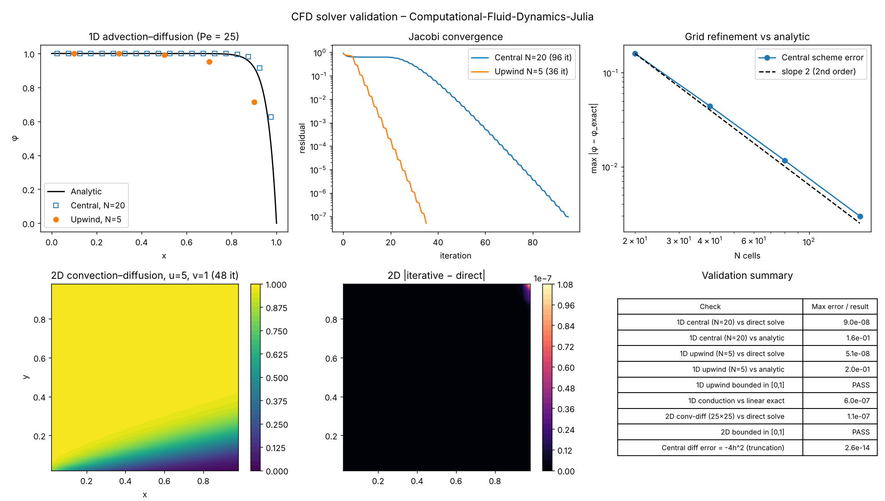

# Computational Fluid Dynamics in Julia

Finite-difference and finite-volume solvers for classic CFD model problems, written in **Julia** and checked by an automated validation suite.

The repository goes from first principles (finite-difference approximations of derivatives) to steady **1D and 2D convection–diffusion** solved with iterative (Jacobi-type) schemes, comparing **central** and **upwind** differencing.

---

## Solvers

| Script | Problem | Method |
| --- | --- | --- |
| `Demo_1DProblem.jl` | 1D steady heat conduction, fixed-temperature ends | Finite differences + Jacobi iteration, convergence history |
| `Advection_Diffusion_OneDim.jl` | 1D steady advection–diffusion, φ(0)=1, φ(L)=0 | Finite volume, **central differencing** for convection |
| `Advection_Diffusion_OneDim_Upwind.jl` | Same problem on a coarse grid (high Péclet number) | Finite volume, **first-order upwind**, bounded solution |
| `TwoDim_Conv_Diff.jl` | 2D convection–diffusion in a unit square, u=5, v=1, Γ=1e-4 | Finite volume, upwind in x and y, edge and corner boundary treatment, contour plot |

## Numerical basics

| Script | Topic |
| --- | --- |
| `Programming_Demo.jl`, `DemoScript.jl` | Forward, backward and central difference approximations of f'(x) for a cubic polynomial |
| `Programming_Demo_2.jl`, `DemoScript_2.jl` | Julia arrays, indexing, loops and control flow used by the solvers |

---

## Validation

`validate.jl` checks every script against an independent reference:

- **1D advection–diffusion:** the iterative result is compared with a direct sparse-matrix solve of the same discrete equations, and with the analytic solution  
  φ(x) = 1 − (e^{Pe·x} − 1)/(e^{Pe} − 1)
- **Upwind scheme:** the solution stays bounded in [0, 1] (no oscillations at high Péclet number)
- **1D conduction:** the solution matches the exact linear profile
- **2D convection–diffusion:** the iterative solution is compared with an assembled N²×N² direct solve, and its boundedness is checked
- **Finite-difference demos:** outputs are checked against exact derivatives, including the h²-truncation error of the central difference

```bash
julia --project=. validate.jl     # exits with code 1 if any check fails
```

### Results



| Check | Result |
| --- | --- |
| 1D central (N=20), iterative vs direct solve | max error 9.0e-08 |
| 1D upwind (N=5), iterative vs direct solve | max error 5.1e-08 |
| 1D conduction vs exact linear profile | max error 6.0e-07 |
| 2D convection–diffusion (25×25), iterative vs direct solve | max error 1.1e-07 |
| Upwind and 2D solutions bounded in [0, 1] | pass |
| Central difference of a cubic, error = −4h² | exact to 2.6e-14 |
| **Grid refinement of the central scheme vs analytic** | **0.160 → 0.044 → 0.012 → 0.003 (N = 20 → 160), second-order** |

**Notes on the results**

- On the 20-cell grid the central scheme differs from the analytic solution by 0.16. The outlet boundary layer (thickness ≈ 1/Pe = 0.04) is thinner than one cell (h = 0.05). The error falls about 4× each time the grid is doubled, which confirms second-order accuracy.
- The cell Péclet number is 1.25 on the 20-cell grid, below the limit of 2 for central differencing. On the 5-cell grid it is 5, where central differencing becomes unstable and the Jacobi iteration diverges. That is why the coarse-grid case uses **upwind**, which stays bounded at any Péclet number but adds numerical diffusion (error 0.20 vs analytic).
- In the 2D case the low-φ region from the bottom wall (φ = 0) is carried up and to the right along the flow direction (u = 5, v = 1, slope 0.2). The inflow value φ = 1 from the left wall fills the rest of the domain. Diffusion is weak (Γ = 10⁻⁴), so the mixing layer between them stays thin.

The figure and table are produced by `reference_check.py`, an independent NumPy implementation of the same discrete equations. It cross-checks the Julia solvers without needing Julia.

---

## Running

Requires Julia 1.9+.

```bash
./run_all.sh                      # installs Plots, validates, runs every script headless (logs in ./logs)
```

Or run a single solver:

```bash
julia --project=. -e 'using Pkg; Pkg.instantiate()'
julia --project=. TwoDim_Conv_Diff.jl
```

---

## Concepts covered

Finite-difference approximations · truncation error · finite-volume discretisation · Péclet number · central vs upwind differencing · boundedness · boundary-condition treatment (Dirichlet at faces, edges and corners) · Jacobi iteration and residual convergence · verification against direct and analytic solutions

## Roadmap

- [ ] Lid-driven cavity (SIMPLE algorithm, staggered grid) validated against Ghia et al. (1982), Re = 100
- [ ] Gauss–Seidel / SOR and a sparse direct solver for faster convergence
- [ ] Higher-order schemes (QUICK, TVD limiters)
- [ ] Transient problems with explicit and implicit time stepping

---

*The model problems follow standard CFD coursework on finite-difference and finite-volume methods. This repository implements them in Julia, with an automated validation suite.*

**Christopher Sathiya Satchi**, Junior Researcher at CIIAE, Spain · [LinkedIn](https://www.linkedin.com/in/christophers828269107/) · [Google Scholar](https://scholar.google.com/citations?user=s9fiBJoAAAAJ)
